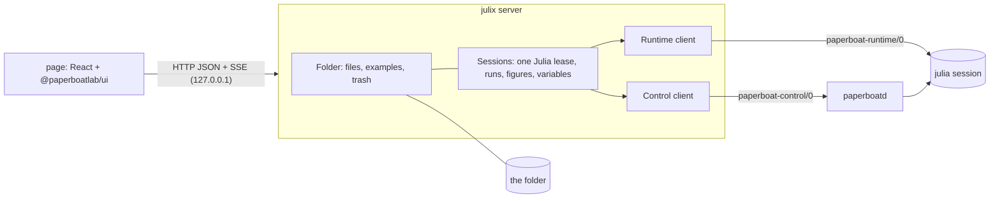

# Architecture

The plan and its decisions: `plans/2026-11-24_22-30_julix_v0_1.md` in the workspace. This page is the
map.

## 1. Overview

Julix is an app server and a page, built like Malachite. The server owns the folder and speaks two
protocols of the platform: `paperboat-control/0` to `paperboatd` for the session lease, and
`paperboat-runtime/0` to the Julia runtime the lease starts. The page is a client of the server only.

## 2. Codemap

- `server/folder.ts`: `Folder`: every path through `resolve` (inside the folder, symlinks too; the
  examples under `@examples/`, read-only), the tree, read/write (atomic), create (a free name), rename,
  copy in, trash (`.julix/trash`).
- `server/session.ts`: `Sessions`: one Julia session lease for the folder, acquired on the first run.
  A run is a file, a cell, a line or a console expression; runs queue, run in their file's folder, keep
  their line numbers (`atLine`), stream output, and turn every SVG or PNG display into a figure in
  `.julix/figures/<run>/`. Variables are asked after each run, before the run reports done. Interrupt
  goes through the daemon (SIGINT); no answer within 3 s restarts the session.
- `server/control.ts`, `server/runtime.ts`: the protocol clients, copied from Malachite.
- `server/main.ts`: the HTTP server: the page from `dist/`, the JSON API, Server-Sent Events.
- `client/`: `App.tsx` (the window: bar, cards, dialogs, Ctrl K), `Code.tsx` (CodeMirror with Julia
  and cells), `cells.ts` (where cells start and end), `Console.tsx` (runs and the REPL line),
  `traceback.ts`, `Workspace.tsx` (Variables, Figures), `Keys.tsx` (the runtimes key, the Panels key),
  `Tree.tsx` (the tree and the file menu), `files.tsx` (file icons), `api.ts`.

## 3. Invariants

1. **The files are the record.** `.julix/` (figures, trash) can be deleted; nothing a script needs
   lives only there or in the server's memory.
2. **Julix runs no code.** Code runs in the runtime leased from `paperboatd`; the server only speaks the
   protocols (paperboat ARCHITECTURE invariant 9).
3. **Paths stay in the folder.** Every path from the page goes through `Folder.resolve`; the examples
   are read-only.
4. **An error points at the user's line.** Code run from line n is sent with n − 1 blank lines before
   it and labelled with its file, so Julia's traceback names the file and line in the editor.
5. **A figure is shown, never run.** Figures are served with a CSP that allows no script, and shown as
   images.
6. **Local only.** The server listens on 127.0.0.1 and answers only its own Host and Origin.
