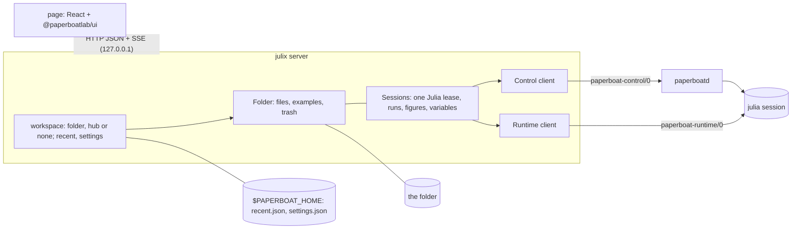

# Architecture

The plan and its decisions: `plans/2026-11-24_22-30_julix_v0_1.md` in the workspace. This page is the
map.

## 1. Overview

Julix is an app server and a page, built like Malachite. The server owns the workspace (a folder, a hub,
or none: the page shows Start; switched at runtime, plans/2026-11-26_11-05_one_file_workflow.md) and speaks two
protocols of the platform: `paperboat-control/0` to `paperboatd` for the session lease, and
`paperboat-runtime/0` to the Julia runtime the lease starts. The page is a client of the server only.

## 2. Codemap

- `server/folder.ts`: `Folder`: every path through `resolve` (inside the folder, symlinks too; the
  examples under `@examples/`, read-only), the tree, read/write (atomic), create (a free name), rename,
  copy in, trash (`.julix/trash`).
- `server/session.ts`: `Sessions`: one Julia session lease for the folder, acquired on the first run.
  A run is a file, a cell, a line or a console expression; runs queue, run in their file's folder, keep
  their line numbers (`atLine`), stream output, and turn every SVG or PNG display into a figure in
  `.julix/figures/<run>/` (a JulixPlot figure as `<n>.json`: the Paperboat figure MIME, its scene and
  buffers; `<n>.thumb.png` its preview, which the page sends once it has drawn the figure, since the
  runtime sends a scene and never an image). Variables are asked after each run, before the run reports
  done. Interrupt goes through the daemon (SIGINT); no answer within 3 s restarts the session. Before the
  first session JulixPlot is added to the folder's project if `Project.toml` doesn't list it; a runtime
  that ends while starting is noticed at once (its lease's event) and retried once. A debug run is an
  `eval` with `debug` and the file's breakpoints (paperboat docs/runtime.md "Debugging"); its stops
  become `debug` events (the last kept for a page that opens later), and `/api/debug` steers it at once,
  never queued behind it.
- `server/packages.ts`: the folder's Julia packages the platform's way (the CLI's recipe): an exec lease
  changes the project, with the network for an add only; `JULIXPLOT=<checkout>` develops a local JulixPlot.
- `server/hubs.ts`: the hubs (paperboat#16), from `paperboat hub list --json` (`$PAPERBOAT` or on PATH, no
  shell), read when the page asks; a CLI that is missing or fails means no hubs, and the page says nothing
  about them (no Malachite, no hub). `holds` counts a hub's scripts for Connect to a hub. `.malachite/` is
  a dot folder: never in the tree. New hub is `paperboat hub new`, Open in Malachite `paperboat app open malachite`.
- `server/store.ts`: the store every app shares under `$PAPERBOAT_HOME` (resolved as paperboat's
  `paths.cpp`): `recent.json` (folders, hubs and files opened, newest first, one per kind and path, 40 at
  most) and `settings.json` (the theme), each written whole to a temp file and renamed.
- `server/control.ts`, `server/runtime.ts`: the protocol clients, copied from Malachite.
- `server/main.ts`: the HTTP server: the page from `dist/`, the JSON API, Server-Sent Events. The
  workspace (`{kind: "folder" | "hub", root, name, hub?}` or null) switches at runtime through `workIn`: a
  new `Folder`, a new `Sessions` (the old Julia session is released) and a new watcher; Open folder takes
  a whole path (a hub's folder opens as the hub), connect a hub's id, Close null. A file opened by its whole
  path from outside the workspace moves it to the file's hub (when a known hub holds it) or its folder;
  Save as to a whole path writes, then opens the same way. What opens goes first in `recent.json`. With no
  workspace only the workspace, recent, settings, hubs and runtimes calls answer (409 otherwise). The editor's
  `lint` and `complete` pass through `/api/session` as the runtime answers them. Julix's own questions
  (a variable's numbers for the plot and the variable editor, setting them, Help's names and docstrings)
  are quiet evals: queued with runs, printed not returned, so `ans` and the console stay the user's.
- `client/`: `App.tsx` (the window: the bar (the kit's `MenuBar`: File from the kit's `fileMenu`, Edit, View,
  Kernel, Help, every item a command of one registry that the command search and `useShortcuts` read too;
  the `WorkspaceWell`; `WindowKeys` last), the `Start` page with no workspace, the one file workflow's
  dialogs (`AskOpen`, `ConnectHub`, our `OpenFile` / `SaveFile` over a hub, `TypedPath` in a browser,
  `Unsaved`), the system's dialogs through the Paperboat window's `shell()`, cards, the file menus, the tab strip with pinned
  tabs (kit `EditorTabs`, `tabMenu`), the debug dock over the editor (kit `DebugDock`), the breakpoint gutter's menu),
  `Code.tsx` (the kit's Editor with Julix's cells and run keys, the running block's outline and spinner,
  the inline result chips, the breakpoint gutter and the line a debug run waits at), `Debug.tsx` (the
  Debug tab: Start debugging, call stack, locals, Watch, breakpoints; breakpoints and Watch kept in the browser), `cells.ts` (where cells start and end), `results.ts` (what each top-level line of a run made:
  names, a function, a drawing; per file, the last run's), `Console.tsx` (runs and
  the REPL line), `traceback.ts`, `Workspace.tsx` (Variables on the kit's `VariableList`, the open row plotted, Figures),
  `Keys.tsx` (the folder's Julia session as the kit's `RuntimesKey`), `Packages.tsx` (the packages dialog), `api.ts` (with the session the
  editor lints and completes through).
- `client/figure/`: `Figure.tsx` (a figure file: a JulixPlot scene to FigureView, else its image),
  `FigureView.tsx` and `scene.ts` (from legacy MX: the figure's grid; 2D axes on the kit's `Plot2D`,
  colour bars, legends, TeX labels; 3D axes on the stage, their ink and grid the paper's `--paper-ink`/`--paper-grid`).
- 3D figures draw on the kit's stage (`@paperboatlab/ui/stage`: three.js, orbit, view cube, axes),
  shared with Simplicial's Station.
- From `@paperboatlab/ui`: the editor with its settings key, Julia's grammar, lint and completion
  (`/editor`), the file tree (`/files`), `Plot2D`, `Heatmap`, `Colorbar`, `TexText` (`/plot`), the package
  manager (`/packages`), `HelpWindow` (F1), `VariableEditor`, the Panels key, and the rest of the kit.

## 3. Invariants

1. **The files are the record.** `.julix/` (figures, trash) can be deleted; nothing a script needs
   lives only there or in the server's memory.
2. **Julix runs no code.** Code runs in the runtime leased from `paperboatd`; the server only speaks the
   protocols (paperboat ARCHITECTURE invariant 9).
3. **Paths stay in the workspace.** Every path from the page goes through `Folder.resolve`; the examples
   are read-only. The one exception is a whole path the user picked (Open folder…, Open file…, Save as…):
   it moves the workspace to it, never reads or writes beside it.
4. **An error points at the user's line.** Code run from line n is sent with n − 1 blank lines before
   it and labelled with its file, so Julia's traceback names the file and line in the editor.
5. **A figure is data or an image, never a page.** A JulixPlot figure is JSON the page draws; any other
   figure is served with a CSP that allows no script, and shown as an image.
6. **Local only.** The server listens on 127.0.0.1 and answers only its own Host and Origin.
