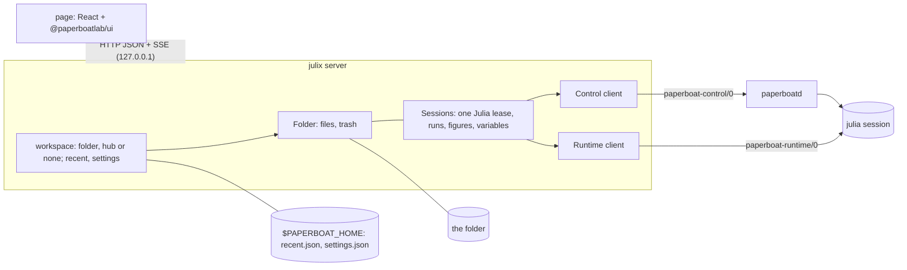

# Architecture

The plan and its decisions: `plans/2026-11-24_22-30_julix_v0_1.md` in the workspace. This page is the
map.

## 1. Overview

Julix is an app server and a page, built like Malachite. The server owns the workspace (a folder, a hub,
or none: the page shows Start; switched at runtime, plans/2026-11-26_11-05_one_file_workflow.md) and speaks two
protocols of the platform: `paperboat-control/0` to `paperboatd` for the session lease, and
`paperboat-runtime/0` to the Julia runtime the lease starts. The page is a client of the server only.

## 2. Codemap

- `server/folder.ts`: `Folder`: every path through `resolve` (inside the folder, symlinks too), the tree,
  read/write (atomic), create (a free name), rename, duplicate, trash (`.julix/trash`). The examples are not in it.
- `server/session.ts`: `Sessions`: one Julia session lease for the folder, started as the folder opens (the julix
  command's `eager`; a test's starts with its first run) and again after Restart, and warmed before it says it is
  ready (`WARMUP`: JulixPlot loaded and a 2D and 3D figure shown, a value shown, the variables listed; #43), so the
  first run doesn't pay Julia's compile time. A run sent meanwhile stays queued (the Console: waiting for Julia);
  a session that doesn't start says why (the page's toast offers Retry, `POST /api/session/start`), never retried
  on a loop.
  A run is a file, a cell, a line or a console expression; runs queue, run in their file's folder with its absolute
  path there as their cell (`enter`: `@__DIR__`, `@__FILE__` and a relative `include` are the file's, as with
  `julia file.jl`; the console is a REPL in the folder's root; #46), keep their line numbers (`atLine`), stream output (to the page as `output` events: only what is new, at most every
  50 ms; the whole run with each change of its state), and turn every SVG or PNG display into a figure in
  `.julix/figures/<run>/` (a JulixPlot figure as `<n>.json`: the Paperboat figure MIME, its scene and
  buffers; `<n>.thumb.png` its preview, which the page sends once it has drawn the figure, since the
  runtime sends a scene and never an image). Variables are asked after each run, before the run reports
  done. Interrupt goes through the daemon (SIGINT); no answer within 3 s restarts the session. Before the
  first session the folder's packages are made ready (`server/packages.ts`), the start's toast following Pkg's
  latest line; a runtime
  that ends while starting is noticed at once (its lease's event) and retried once. A debug run is an
  `eval` with `debug` and the file's breakpoints (paperboat docs/runtime.md "Debugging"); its stops
  become `debug` events (the last kept for a page that opens later), and `/api/debug` steers it at once,
  never queued behind it.
- `server/share.ts`: Julix's shared variables (plans/2026-11-27_00-15_julix_simplicial_shared_variables.md): the
  running Simplicial stations, from the records their engine keeps (`/tmp/paperboat-runtime/station-<port>.json`, a
  dead pid skipped), each held on a WebSocket (paperboat/0, scanned every 5 s), sent `variables.set` with `source:
  "julix"` whenever the session's variables change (a run, the variable editor, a new or ended session).
  `Sessions.shared` reads them in one quiet eval: real numbers, Bools, one-line text, real arrays as a matrix by its
  rows up to 4096 values (larger: a note). Only the julix command shares (`serve`'s `share`), never a test. The
  station resolves the flow's own variables first and these under the names left; closing the socket drops them.
  Every Julix window connects, so an empty list goes only to a station this one gave variables (julix#44), and a
  failing socket is left to close itself (closing it from `error` recursed until the server died, julix#51).
- `server/packages.ts`: the folder's packages before its first session, the platform's way (the CLI's recipe):
  an exec lease with the network for that step only. JulixPlot is added (a writable project) when `Project.toml`
  doesn't list it; otherwise what `Manifest.toml` records and the folder's deps volume lacks (paperboatd keeps one
  per runtime and project path: an example, a moved folder, a fresh install start empty; checked on the host, by
  Pkg's `packages/<name>/<slug>` folders) is instantiated with the project read-only, the Manifest left as it is
  (julix#39). `JULIXPLOT=<checkout>` develops a local JulixPlot. Julix has no package manager of its own: Paperboat Launcher › Runtimes › julia › Packages is the one
  for Julia (`paperboat package add|remove julia …`, paperboat#50); the Runtimes key, Settings › Julix and the
  disabled Kernel › Julia packages… say so, and Kernel › Manage runtimes… goes there (`POST /api/launcher`:
  `paperboat launcher --page runtimes --runtime julia`, paperboat#69).
- `server/hubs.ts`: the hubs (paperboat#16), from `paperboat hub list --json` (`$PAPERBOAT_BIN` or on PATH, no
  shell), read when the page asks; a CLI that is missing or fails means no hubs, and the page says nothing
  about them (no Malachite, no hub). `holds` counts a hub's scripts for Connect to a hub. `.malachite/` is
  a dot folder: never in the tree. New hub is `paperboat hub new`, Open in Malachite `paperboat app open malachite`.
  The examples (paperboat#72, #75) come from the same CLI: `GET /api/examples` is `paperboat example list --app julix`
  (a missing or failing CLI: none), read once as the page loads, and each is a Ctrl K command, **Open example:
  <name>** (the kit's `exampleCommands`, in no menu); `POST /api/examples/open {id}` runs `paperboat example open
  <id> [--to <the workspace folder>]`, which opens the example where it is (its checkout, or GitHub's copy in
  `$PAPERBOAT_HOME/cache/examples`) in a new window whose URL says so (`?example=&name=[&to=][&cache=1]`). That
  page reads it once as it loads (the kit's `exampleFromUrl`; a reload in another workspace drops it) and shows the
  kit's `ExampleBanner` at the top of the bay; its Copy is `POST /api/examples/copy {id, to}` (`to`: a whole path),
  `paperboat example copy <id> --to <to> --open`, into `to` or, with none, a folder picked as Open folder… picks.
  The CLI's error goes to the page as a toast. With `--json` the CLI says why it failed as `{error}`, which `paperboat()` reports.
- `server/examples.ts`: an example opened in place is read-only. The platform starts this server on the example's
  folder and tells only the page (its URL), so the server finds out itself: `Examples` knows the examples' roots
  (`$PAPERBOAT_HOME/cache/examples`, `$PAPERBOAT_EXAMPLES_DIR`, and `<root>` of every `<root>/<group>/<example>` that
  `example list` gives, read once as the server starts, which `GET /api/examples` serves). A workspace in a root is
  `readOnly` (with `example: {id, name, cache}`): the `Folder` refuses every write under a root (403, "copy it"),
  in any workspace; Save as and the banner's Copy refuse a target there; its figures go to a scratch folder
  (`$TMPDIR/julix-example-<uid>/<hash>`, `Folder.data`); a run's folder is in a copy of the example the session
  makes once in its own temp folder (`enter(source, true)`: `ENV["JULIX_SCRATCH"]`), so `out/` and the like never land
  in it; JulixPlot is not added (its Manifest is still instantiated into the deps volume, the project read-only,
  as for any folder); nothing of it goes into `recent.json`, and `GET /api/recent` and the hub list
  (`/api/hubs`, Connect to a hub, a file's hub) leave the examples' folders out. The page shows the banner (from the
  URL, else from `example`), the editor read-only, and Save, New, Rename, Duplicate, Delete, a drag off.
- `server/store.ts`: the store every app shares under `$PAPERBOAT_HOME` (resolved as paperboat's
  `paths.cpp`): `recent.json` (folders, hubs and files opened, newest first, one per kind and path, 40 at
  most) and `settings.json` (the theme), each written whole to a temp file and renamed; and `julix.toml`
  under `$XDG_CONFIG_HOME/paperboat` (as Articula's `articula.toml`), the editor settings the kit's
  `useEditorSettings` reads and writes (`GET`/`PUT /api/config`), one file for every Julix window whatever its port.
- `server/control.ts`, `server/runtime.ts`: the protocol clients, copied from Malachite.
- `server/main.ts`: the HTTP server: the page from `dist/` (its bundle named by content hash, kept by the browser;
  `index.html` asked again, with an ETag), the JSON API, Server-Sent Events. The
  workspace (`{kind: "folder" | "hub", root, name, hub?}` or null) switches at runtime through `workIn`: a
  new `Folder`, a new `Sessions` (the old Julia session is released) and a new watcher; Open folder takes
  a whole path (a hub's folder opens as the hub), connect a hub's id, Close null. A file opened by its whole
  path from outside the workspace moves it to the file's hub (when a known hub holds it) or its folder;
  Save as to a whole path writes, then opens the same way. What opens goes first in `recent.json`. With no
  workspace only the workspace, recent, settings, hubs and runtimes calls answer (409 otherwise). The editor's
  `lint` and `complete` pass through `/api/session` as the runtime answers them. Julix's own questions
  (a variable's numbers for the plot and the variable editor, setting them, Help's names and docstrings)
  are quiet evals: queued with runs, printed not returned, so `ans` and the console stay the user's.
- `client/`: `App.tsx` (the window: the bar (the kit's `MenuBar`: File from the kit's `fileMenu`, Edit, View,
  Kernel, Help, every item a command of one registry that the command search and `useShortcuts` read too;
  the `WorkspaceWell`; `WindowKeys` last), the kit's `Settings` window (General: the theme; Julix: the
  runtime and the project; Editor: `EditorSettingsPane`; Hub, in a hub; Shortcuts: `ShortcutList`), the `Start` page with no workspace, the one file workflow's
  dialogs (`AskOpen`, `ConnectHub`, our `OpenFile` / `SaveFile` over a hub, `TypedPath` in a browser,
  `Unsaved`), the system's dialogs through the Paperboat window's `shell()`, cards, the file menus, the tab strip with pinned
  tabs (kit `EditorTabs`, `tabMenu`), the debug dock over the editor (kit `DebugDock`), the breakpoint gutter's menu),
  `Code.tsx` (the kit's Editor with Julix's cells and run keys, the running block's outline and spinner,
  the inline result chips, the breakpoint gutter and the line a debug run waits at), `Debug.tsx` (the
  Debug tab: Start debugging, call stack, locals, Watch, breakpoints; breakpoints and Watch kept in the browser), `cells.ts` (where cells start and end), `results.ts` (what each top-level line of a run made:
  names, a function, a drawing; per file, the last run's), `Console.tsx` (runs and
  the REPL line), `traceback.ts`, `Workspace.tsx` (Variables on the kit's `VariableList`, the open row plotted, Figures),
  `Keys.tsx` (the folder's Julia session as the kit's `RuntimesKey`), `api.ts` (with the session the
  editor lints and completes through; a completion sends the statement at the cursor, not the whole script).
  What is typed is in `App`'s `draftRef`; the page redraws from it when the script becomes unsaved or typing
  pauses, and the cursor reaches only the editor's footer, so a key redraws the editor alone.
- `client/figure/`: loaded with the first figure shown (`scripts/build.ts` splits the bundle: this and three.js
  are most of it). `Figure.tsx` (a figure file: a JulixPlot scene to FigureView, else its image; a figure that
  throws while drawn, as a 3D axis with no WebGL context does, fails in the pane with a message, the page stays),
  `FigureView.tsx` and `scene.ts` (from legacy MX: the figure's grid; 2D axes on the kit's `Plot2D`,
  colour bars, legends, TeX labels; 3D axes on the stage, their ink and grid the paper's `--paper-ink`/`--paper-grid`).
- 3D figures draw on the kit's stage (`@paperboatlab/ui/stage`: three.js, orbit, view cube, axes),
  shared with Simplicial's Station.
- From `@paperboatlab/ui`: the editor and its settings pane, Julia's grammar, lint and completion
  (`/editor`), the file tree (`/files`), `Plot2D`, `Heatmap`, `Colorbar`, `TexText` (`/plot`), `HelpWindow` (F1), `VariableEditor`, the Panels key, and the rest of the kit.

## 3. Invariants

1. **The files are the record.** `.julix/` (figures, trash) can be deleted; nothing a script needs
   lives only there or in the server's memory.
2. **Julix runs no code.** Code runs in the runtime leased from `paperboatd`; the server only speaks the
   protocols (paperboat ARCHITECTURE invariant 9).
3. **Paths stay in the workspace.** Every path from the page goes through `Folder.resolve`. The one exception is a whole path the user picked (Open folder…, Open file…, Save as…):
   it moves the workspace to it, never reads or writes beside it.
4. **An error points at the user's line.** Code run from line n is sent with n − 1 blank lines before
   it and labelled with its file, so Julia's traceback names the file and line in the editor.
5. **A figure is data or an image, never a page.** A JulixPlot figure is JSON the page draws; any other
   figure is served with a CSP that allows no script, and shown as an image.
6. **Local only.** The server listens on 127.0.0.1 and answers only its own Host and Origin.
7. **An example is never written.** Nothing Julix does (a save, a file action, a run, a figure, recent.json)
   writes under the examples' roots; only its Copy makes a folder to change (`test/readonly.test.ts`, and the e2e's
   git-clean run).
